# Stepper ripple compensation

The torque of a stepper motor is not constant within an electrical
period of the motor. The ripple repeats 1, 2 and 4 times per
electrical period, these are the harmonics h1, h2 and h4. At a stepper
speed `v` the harmonic `k` has the frequency

```
f = k * v / P
```

where `P` is the electrical period in mm: 4 full steps, or
`rotation_distance / 50` for a 1.8 degree motor. With a
`rotation_distance` of 40 the period is 0.8 mm, so at 100 mm/s h1 is at
125 Hz, h2 at 250 Hz and h4 at 500 Hz. When the frequency of a harmonic
matches a resonance of the printer, the toolhead vibrates strongly at
that speed. The [stepper_ripple_compensation](
   Config_Reference.md#stepper_ripple_compensation)
module adds a small periodic correction to the stepper position that
cancels the ripple, and the
[stepper_ripple_calibrate](
   Config_Reference.md#stepper_ripple_calibrate)
module finds this correction with an accelerometer.

This document describes the whole calibration step by step. The example
is a corexy printer with 4 motors, a `rotation_distance` of 40 and an
ADXL345 on the toolhead. The calibration consists of:

1. A vibration measurement without the correction.
2. Graphs of the measurement and the choice of the harmonics and
   speeds to calibrate.
3. A calibration of each harmonic.
4. A new vibration measurement and its comparison with the first one.
5. Repeated calibrations at the speeds where vibrations remain.

## Preparation

Each motor needs its own section, as the motors may have different
electrical phases. The motors need TMC drivers, the phase of the motor
is read from the driver.

```
[stepper_ripple_compensation stepper_x]
[stepper_ripple_compensation stepper_x1]
[stepper_ripple_compensation stepper_y]
[stepper_ripple_compensation stepper_y1]

[stepper_ripple_calibrate]
accel_chip: adxl345
```

The accelerometer is mounted on the toolhead as described in
[Measuring Resonances](Measuring_Resonances.md), and the numpy package is
required in the Klipper environment. Before the tests home the printer.

## Step 1: Initial vibration measurement

The sections start without nodes, so there is no correction yet. Run
the vibration test along the Y axis over the range of speeds:

```
STEPPER_RIPPLE_VIBRATION_MEASURE NAME=stepper_x AXIS=Y MIN_SPEED=20 MAX_SPEED=150 SPEED_STEP=1 LABEL=default
```

The toolhead moves forward and backward along Y in the middle of the X
axis at each speed from 20 to 150 mm/s. On corexy all 4 motors turn
in a move along an axis, so the measurement shows the vibrations of
the whole printer, with the harmonics taken relative to the phase of
stepper_x.

Each test move lasts MOVE_TIME, 1.5 seconds by default, at constant
speed plus its acceleration. The move has to fit between the axis limits
with 1 mm left at each end. When it does not
fit, the move time of all the speeds is shortened. The printer of this
example has axes of 235 mm, so 233 mm are available. At 150 mm/s a move
of 1.5 seconds is 225 mm long and fits, up to 155 mm/s the moves keep
their 1.5 seconds, while at 200 mm/s all the moves would take 233 / 200
= 1.17 seconds. A shorter move gives fewer samples and noisier results.

The result is saved to
`~/printer_data/config/adxl_results/stepper_ripple_compensation/`, in
this example as `stepper_ripple_vibration_20261016_143348_default.txt`.
The table has the median vibration and the amplitude of each harmonic
in mm/s^2, the `_rev` columns are the backward moves:

```
speed    rpm   median  median_rev      h1  h1_rev       h2   h2_rev     h3  h3_rev      h4  h4_rev
   49   73.5   5939.0      2561.7   166.4   217.9    555.8    626.4  109.5    96.6  8531.5  3314.4
   61   91.5   6214.2      5165.5   687.9   729.2   2410.5   1885.9  157.2   168.3  8289.4  6833.9
   67  100.5   2955.5      2422.2  2059.3  1680.6   2513.3   1974.7  150.9   262.3  2656.1  1459.4
  100  150.0  12010.5     12537.2   711.2   664.0  17114.1  18261.2  146.9   109.1   543.6   410.7
  112  168.0   8906.9      6348.2   418.5   594.7  12517.0   8311.9  159.3   147.6   198.2   265.2
```

## Step 2: Graphs of the measurement

The tables are plotted with `scripts/stepper_ripple_compare.py`, which
needs matplotlib. The `-c` option selects the column, `median` by default:

```
python3 ~/klipper/scripts/stepper_ripple_compare.py stepper_ripple_vibration_20261016_143348_default.txt
python3 ~/klipper/scripts/stepper_ripple_compare.py stepper_ripple_vibration_20261016_143348_default.txt -c h1
python3 ~/klipper/scripts/stepper_ripple_compare.py stepper_ripple_vibration_20261016_143348_default.txt -c h2
python3 ~/klipper/scripts/stepper_ripple_compare.py stepper_ripple_vibration_20261016_143348_default.txt -c h4
```

The graphs are saved next to the table, for example as
`stepper_ripple_vibration_20261016_143348_default_h2.png`.

The median shows how strong the vibrations are overall:

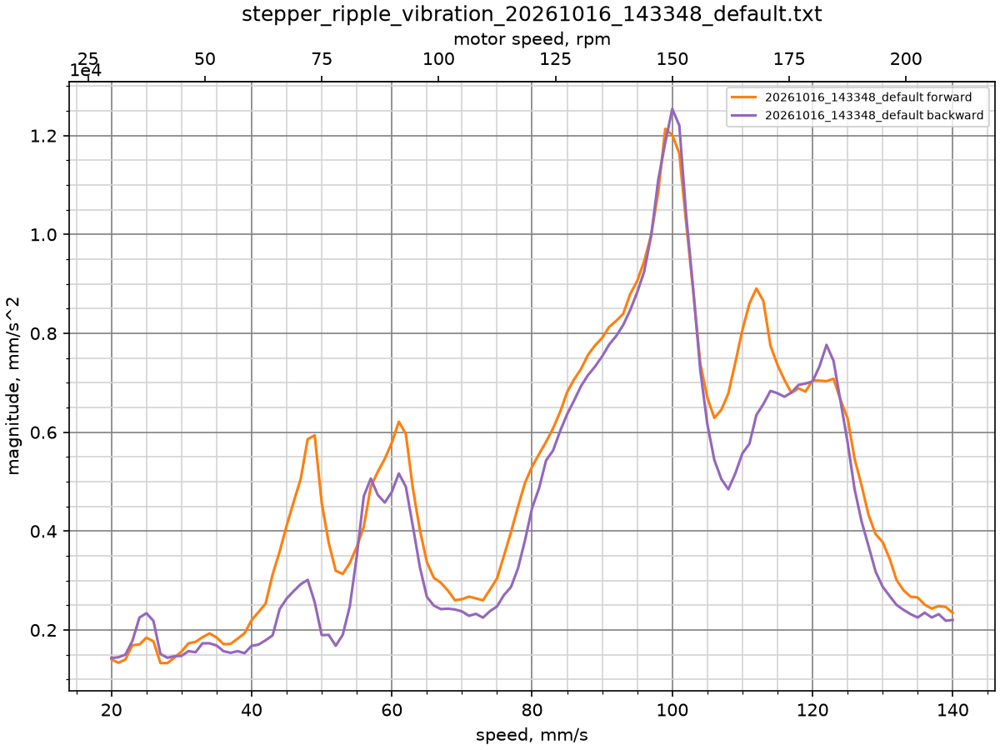

There are peaks at 49, 61, 100, 112 and 122 mm/s, the strongest one
reaches 12500 mm/s^2. The harmonic graphs show which harmonic causes
each peak.

h2 has a wide peak from 75 to 130 mm/s with 17000-18000 mm/s^2 at
100 mm/s. It explains the large median peaks at 100, 112 and 122 mm/s:

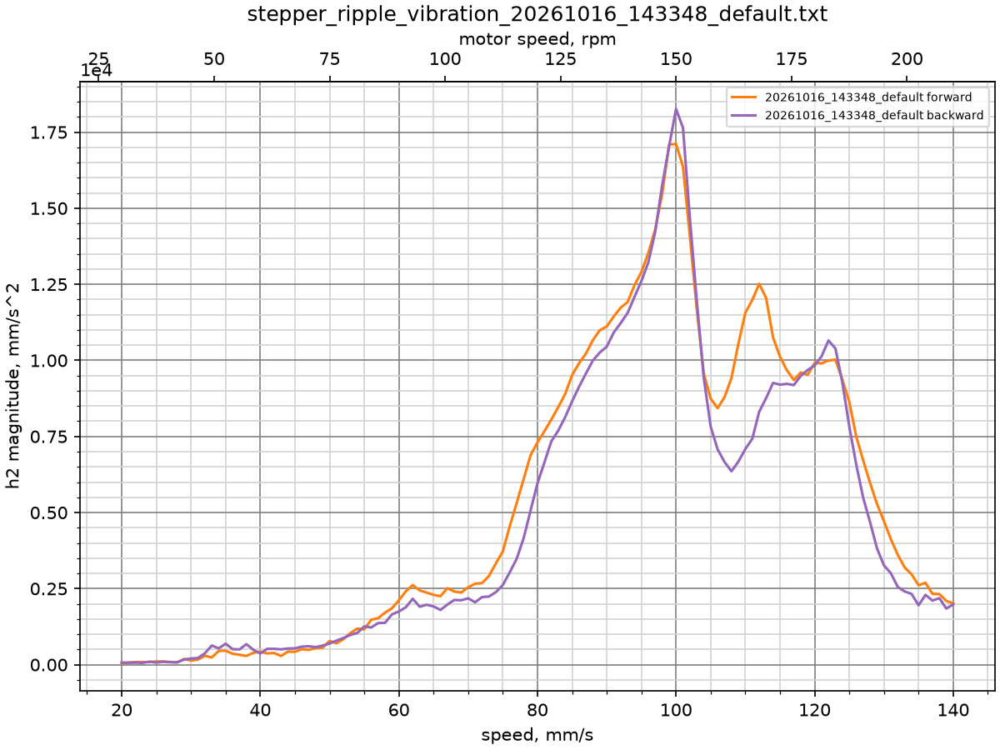

h4 has two peaks of up to 8500 mm/s^2 at 49 and 61 mm/s, the median
peaks at the same speeds:

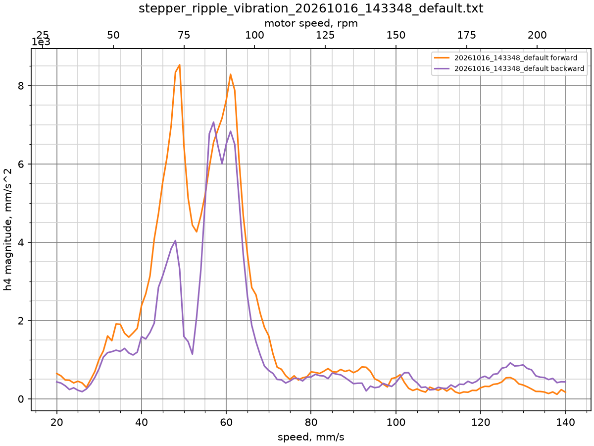

h1 reaches 2000 mm/s^2 at 67 mm/s, it is much smaller than h2 and h4:

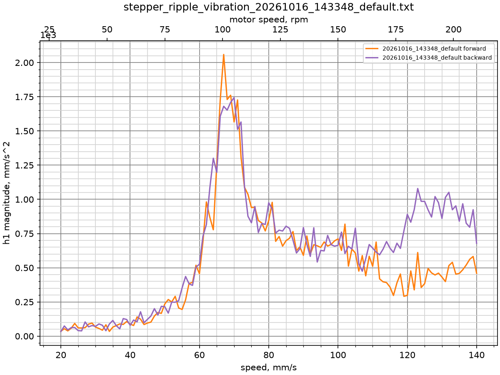

The peaks of different harmonics are often the same resonance of the
printer. The h4 peak at 49 mm/s is at 4 * 49 / 0.8 = 245 Hz and the h2
peak at 100 mm/s at 2 * 100 / 0.8 = 250 Hz. The h4 peak at 61 mm/s and
the h2 peak at 122 mm/s are both at 305 Hz. h3 is usually small and
does not need a correction.

## Step 3: Calibration of the harmonics

### Which harmonic first

Start with the harmonic whose peaks match the largest peaks of the
median graph, here h2, then h4 and then h1. A calibration corrects
only the given harmonic and keeps the correction of the others, so the
order does not have to be exact.

### Which speeds

`SPEEDS` or `MIN_SPEED`, `MAX_SPEED` and `SPEED_STEP` are the speeds of
the test moves. They should cover the whole peak of the harmonic,
including its flanks where the harmonic rises above the background.
At each speed the forward and backward moves are made once with the
current correction and twice for each motor that turns, so a step of
5 to 10 mm/s is usually enough.

`NODE_SPEEDS` are the speeds of the new nodes. The correction is
interpolated linearly between the nodes and is constant below the first
and above the last node, only below a toolhead speed of 2 mm/s it
fades out to zero at standstill. With fewer nodes than test speeds each
node is fitted to the tests around it, which gives a smoother
correction. Place the nodes at the edges of the peak and every 15 to
20 mm/s inside it.
Current nodes outside the range of the new nodes and the tested speeds
are kept. A harmonic can have at most **16 nodes**, the kept ones included,
but there is no need for that many. Many nodes are mostly useful to
cover a wide range of speeds, while dense nodes are each fitted to fewer
tests and follow the noise of the measurement.

`AXIS` is the list of the test moves, as in the vibration test. `DIAG`
moves diagonally so that only one belt turns. `X` and `Y` move along the
axis with both belts, at two positions of the other axis so that the
result does not depend on this position. Using all three makes the
correction fit every kind of move.

### Commands

For h2 the test speeds cover 40 to 150 mm/s and the nodes are placed
every 20 mm/s:

```
STEPPER_RIPPLE_CALIBRATE HARMONIC=2 MIN_SPEED=40 MAX_SPEED=150 SPEED_STEP=10 NODE_SPEEDS=40,60,80,100,120,150 AXIS=DIAG,X,Y
```

For h4 the speeds are dense around the peaks at 49 and 61 mm/s. The
nodes at 100 and 150 mm/s keep the correction defined at higher speeds:

```
STEPPER_RIPPLE_CALIBRATE HARMONIC=4 SPEEDS=40,45,50,55,60,65,70,100,150 NODE_SPEEDS=40,55,70,100,150 AXIS=DIAG,X,Y
```

For h1 around the peak at 67 mm/s:

```
STEPPER_RIPPLE_CALIBRATE HARMONIC=1 SPEEDS=50,60,65,70,75,80,100,120,150 NODE_SPEEDS=50,70,100,150 AXIS=DIAG,X,Y
```

Without NAME all sections are calibrated together. The harmonic
frequency has to stay below 40% of the accelerometer sample rate.

At the end the command reports each test move with three values in mm/s^2:
- `measured` with the current correction,
- `pred` predicted with the new nodes,
- `no_corr` predicted without any correction.

Nodes that are not determined by the measurements, for example of the 2
motors of one belt, are listed after `Poorly determined nodes` and keep
about the values they had before the calibration. Then the new nodes of
each section are listed. They are applied right away, `SAVE_CONFIG` stores
them.

## Step 4: Repeated vibration measurement

Repeat the measurement of step 1 with a new label:

```
STEPPER_RIPPLE_VIBRATION_MEASURE NAME=stepper_x AXIS=Y MIN_SPEED=20 MAX_SPEED=150 SPEED_STEP=1 LABEL=shaped
```

With two tables the script compares them. The first table is the
reference, the second one is compared to it:

```
python3 ~/klipper/scripts/stepper_ripple_compare.py stepper_ripple_vibration_20261016_143348_default.txt stepper_ripple_vibration_20261016_154729_shaped.txt
python3 ~/klipper/scripts/stepper_ripple_compare.py stepper_ripple_vibration_20261016_143348_default.txt stepper_ripple_vibration_20261016_154729_shaped.txt -c h2
```

The graph is saved as
`stepper_ripple_vibration_20261016_154729_shaped_vs_20261016_143348_default_h2.png`,
and the script prints the mean gain and the RMS of both tables:

```
forward: RMS of h2: 20261016_143348_default 7213, 20261016_154729_shaped 1595 (77.9%)
backward: RMS of h2_rev: 20261016_143348_default 6695, 20261016_154729_shaped 1968 (70.6%)
```

After the first calibration of h1, h2 and h4 the RMS of the median
dropped from 5629 to 2086 mm/s^2 forward and from 5151 to 2225 mm/s^2
backward:

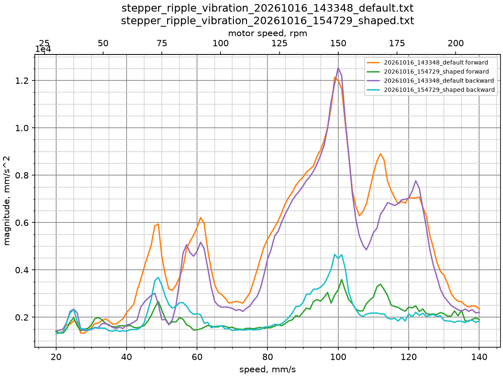

h1 dropped by 75-78% and is now at the level of the noise:

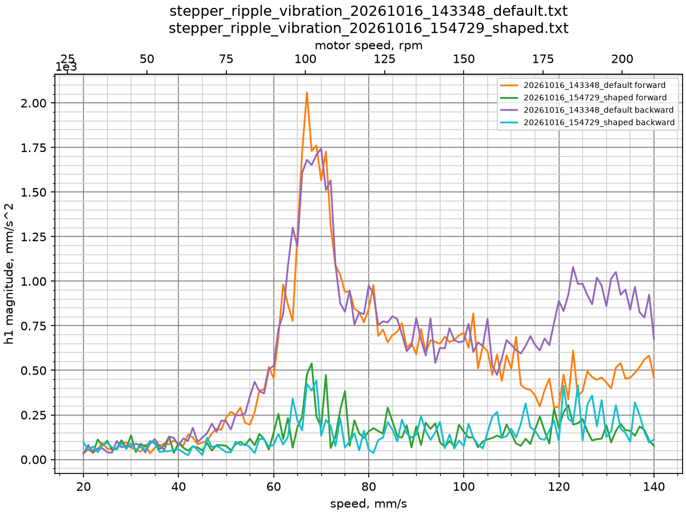

h2 dropped by 71-78%, but a peak of 4400-6300 mm/s^2 remains at
100 mm/s:

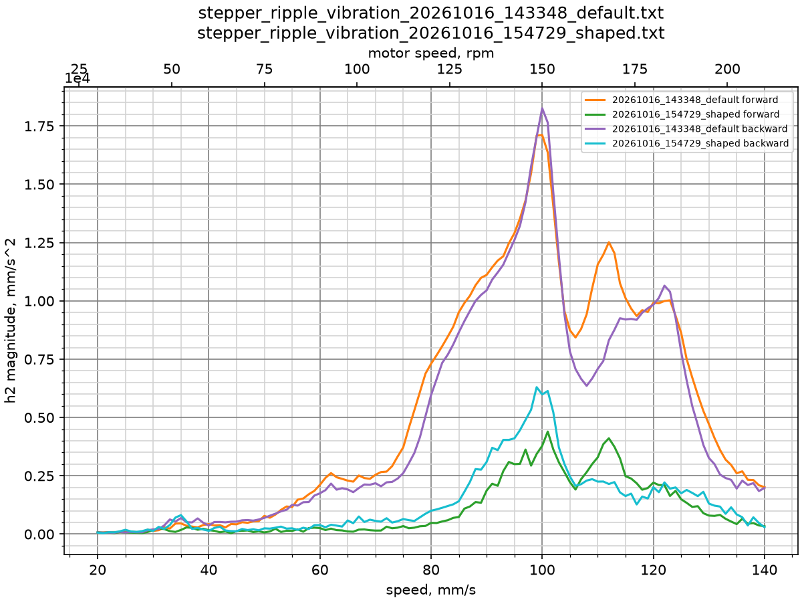

h4 dropped by 67% forward and only by 38% backward, up to
5000 mm/s^2 remain at 48 mm/s:

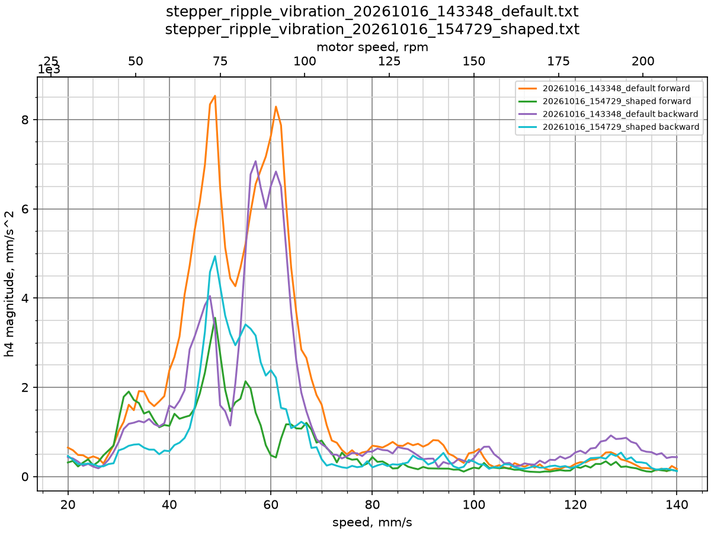

## Step 5: Repeated calibration

If a harmonic still has a peak, run its calibration again only in the
range of the peak. The calibration starts from the current correction
and measures what remains of the vibration, so each run refines the
correction. The new nodes replace the current nodes only in their
range, the other nodes stay unchanged.

For the h2 peak at 100 mm/s the speeds cover 80 to 150 mm/s, the
nodes at 40 and 60 mm/s are kept from the previous calibration:

```
STEPPER_RIPPLE_CALIBRATE HARMONIC=2 MIN_SPEED=80 MAX_SPEED=150 SPEED_STEP=5 NODE_SPEEDS=80,100,120,150 AXIS=DIAG,X,Y
```

After a new measurement with `LABEL=shaped1` the RMS of h2 is 91-92%
below the initial one and the peak at 100 mm/s is gone:

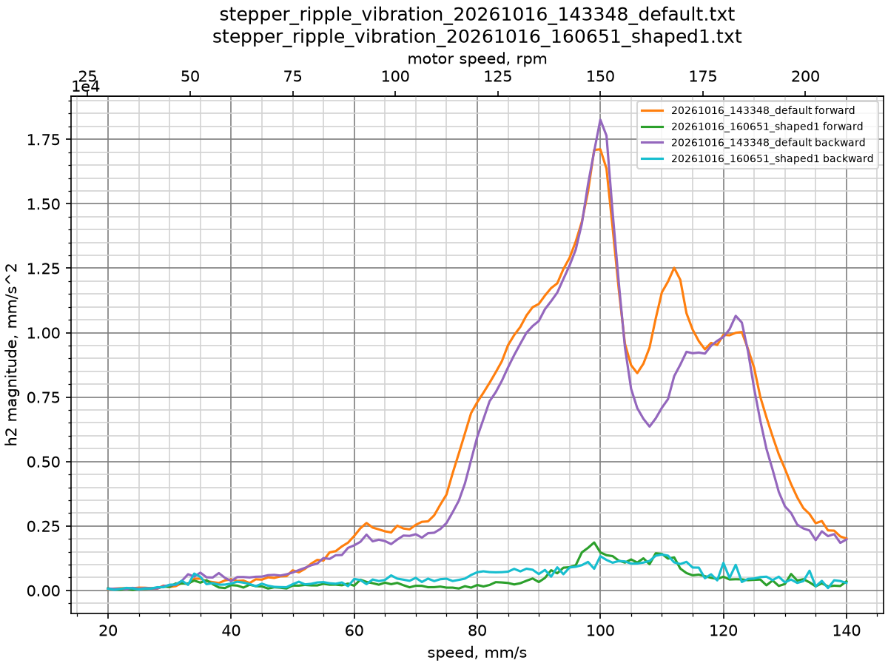

For the h4 peak at 48 mm/s the speeds cover 40 to 60 mm/s. The nodes
at 40 and 60 mm/s replace the nodes at 40 and 55 mm/s, the nodes from
70 mm/s up are kept:

```
STEPPER_RIPPLE_CALIBRATE HARMONIC=4 MIN_SPEED=40 MAX_SPEED=60 SPEED_STEP=2 NODE_SPEEDS=40,60 AXIS=DIAG,X,Y
```

After a new measurement with `LABEL=shaped2` the RMS of h4 is 71-81%
below the initial one:

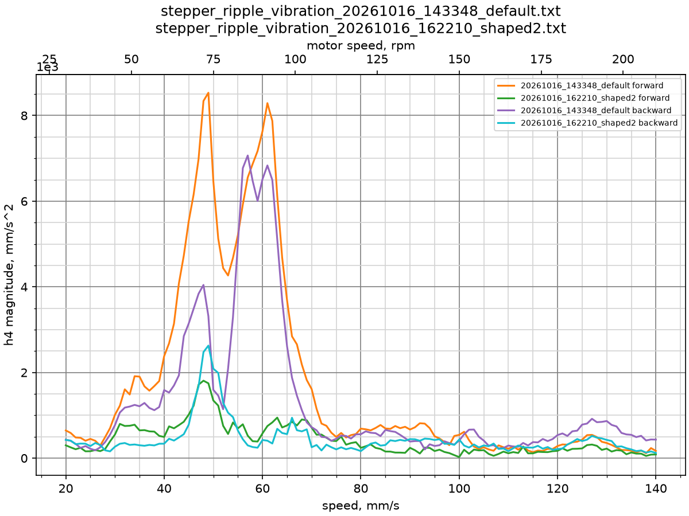

The median is now flat at 1400-2400 mm/s^2 over the whole speed range,
compared to peaks of 12500 mm/s^2 without the correction. Its RMS
dropped by ~70%:

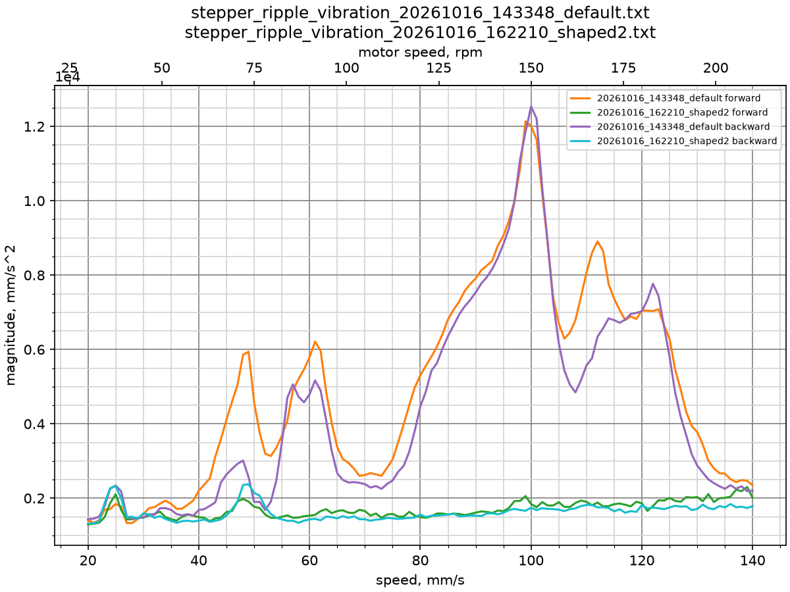

Repeat steps 4 and 5 while the graph of a harmonic still has a peak,
speeds at which it is clearly higher than at the speeds around them,
and the peak keeps getting lower after each calibration. The
calibration can be stopped when a new run no longer lowers the peak on
the graph, or when the predicted values `pred` are close to the
measured ones, a new run would not improve the correction. Finally
store the nodes with `SAVE_CONFIG`.
