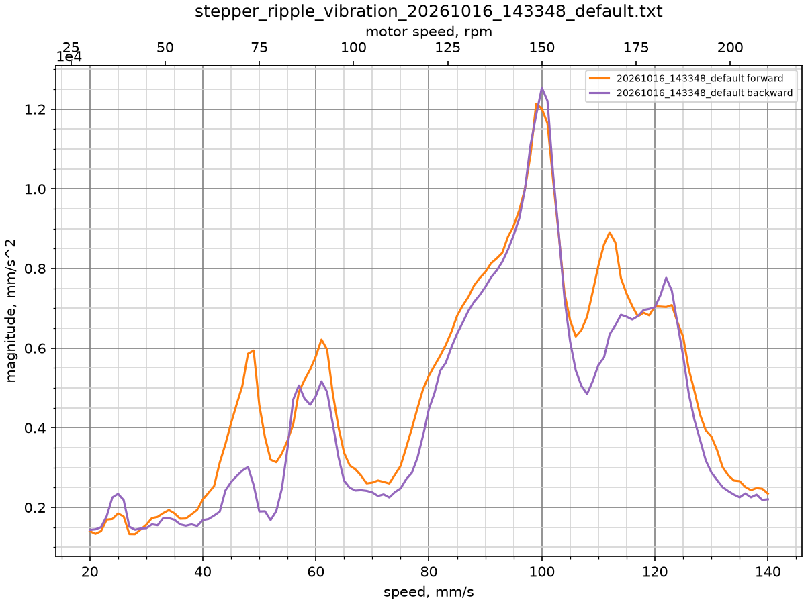
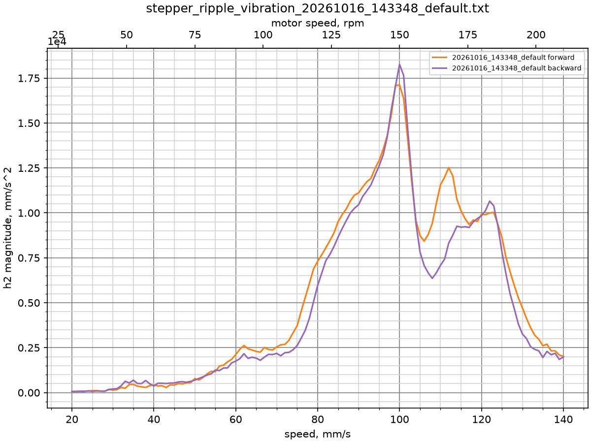
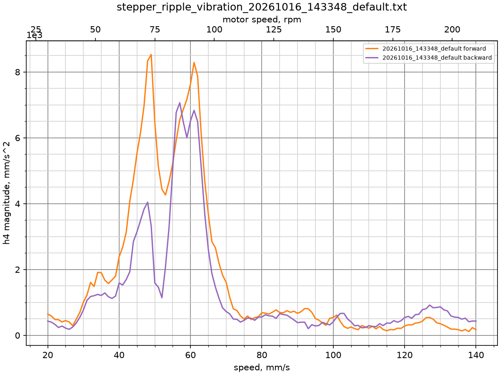
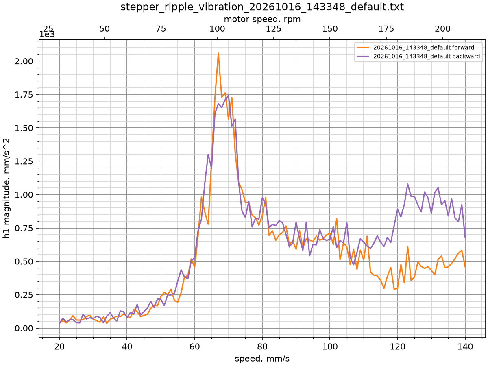
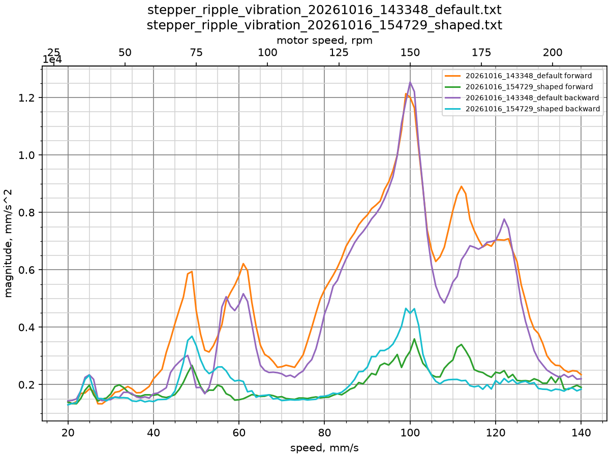
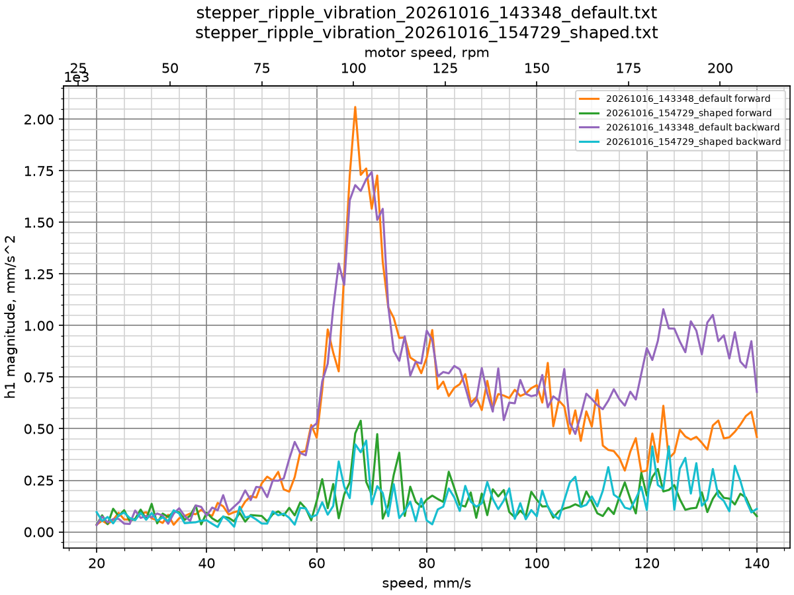
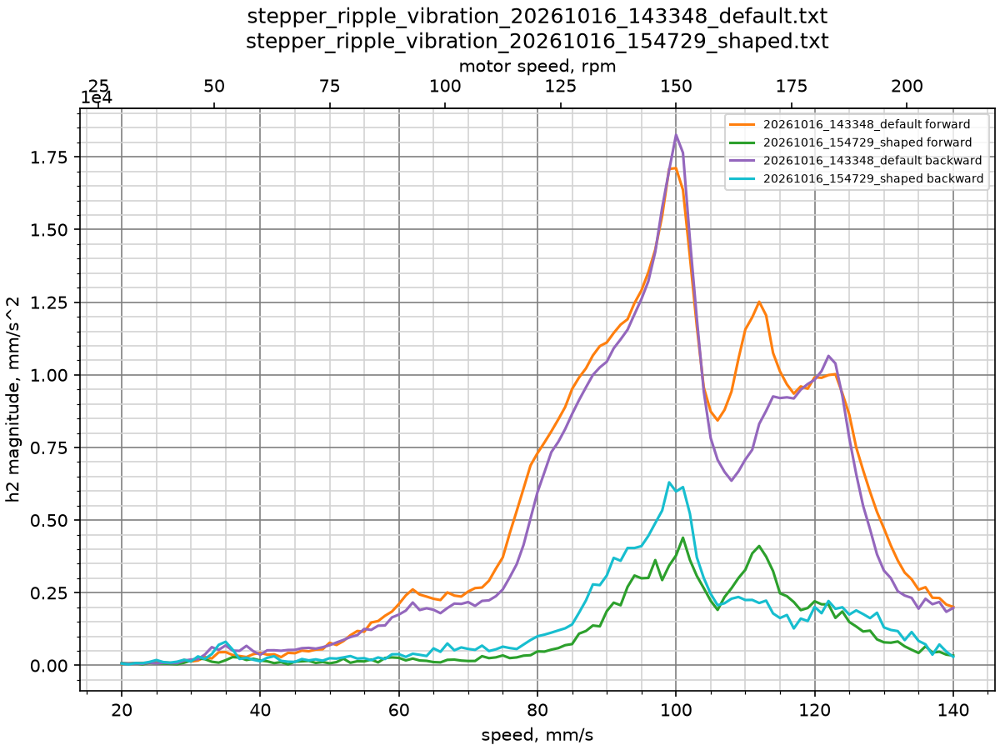
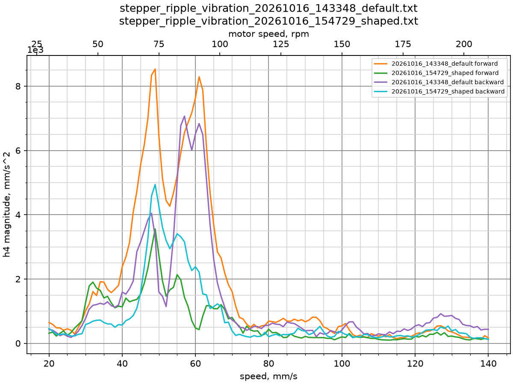

# Stepper ripple compensation

The torque of a stepper motor is not constant within an electrical
period of the motor. The ripple repeats 1, 2 and 4 times per
electrical period, these are the harmonics h1, h2 and h4. At a stepper
speed `v` the harmonic `k` has the frequency

```
f = k * v / P
```

where `P` is the electrical period in mm: 4 full steps, or
`rotation_distance / 50` for a 1.8 degree motor. With a
`rotation_distance` of 40 the period is 0.8 mm, so at 100 mm/s h1 is at
125 Hz, h2 at 250 Hz and h4 at 500 Hz. When the frequency of a harmonic
matches a resonance of the printer, the toolhead vibrates strongly at
that speed. The [stepper_ripple_compensation](
   Config_Reference.md#stepper_ripple_compensation)
module adds a small periodic correction to the stepper position that
cancels the ripple, and the
[stepper_ripple_calibrate](
   Config_Reference.md#stepper_ripple_calibrate)
module finds this correction with an accelerometer.

The calibration needs only the range of speeds. The vibration
measurements before and after it show its effect. The example is a
corexy printer with 4 motors, a `rotation_distance` of 40 and an
ADXL345 on the toolhead.

## Preparation

Each motor needs its own section, as the motors may have different
electrical phases. The motors need TMC drivers, the phase of the motor
is read from the driver.

```
[stepper_ripple_compensation stepper_x]
[stepper_ripple_compensation stepper_x1]
[stepper_ripple_compensation stepper_y]
[stepper_ripple_compensation stepper_y1]

[stepper_ripple_calibrate]
accel_chip: adxl345
```

The accelerometer is mounted on the toolhead as described in
[Measuring Resonances](Measuring_Resonances.md), and the numpy package is
required in the Klipper environment. Before the tests home the printer.

## Step 1: Initial vibration measurement

The sections start without a correction. Run
the vibration test along the Y axis over the range of speeds:

```
STEPPER_RIPPLE_VIBRATION_MEASURE NAME=stepper_x AXIS=Y MIN_SPEED=20 MAX_SPEED=150 SPEED_STEP=1 LABEL=default
```

The toolhead moves forward and backward along Y in the middle of the X
axis at each speed from 20 to 150 mm/s. On corexy all 4 motors turn
in a move along an axis, so the measurement shows the vibrations of
the whole printer, with the harmonics taken relative to the phase of
stepper_x.

Each test move lasts MOVE_TIME, 1.5 seconds by default, at constant
speed plus its acceleration. The move has to fit between the axis limits
with 1 mm left at each end, the moves of the speeds that do not fit are
shortened. The printer of this example has axes of 235 mm, so 233 mm
are available. At 150 mm/s a move of 1.5 seconds is 225 mm long and
fits, up to 155 mm/s the moves keep their 1.5 seconds, while a move at
200 mm/s takes 233 / 200 = 1.17 seconds. A shorter move gives fewer
samples and noisier results. The analyzed part of the move starts and
ends about 0.05 seconds after the acceleration, a speed whose analyzed
part would be shorter than 0.2 seconds is refused.

The result is saved to
`~/printer_data/config/adxl_results/stepper_ripple_compensation/`, in
this example as `stepper_ripple_vibration_20261016_143348_default.txt`.
The table has the median vibration and the amplitude of each harmonic
in mm/s^2, the `_rev` columns are the backward moves:

```
speed    rpm   median  median_rev      h1  h1_rev       h2   h2_rev     h3  h3_rev      h4  h4_rev
   49   73.5   5939.0      2561.7   166.4   217.9    555.8    626.4  109.5    96.6  8531.5  3314.4
   61   91.5   6214.2      5165.5   687.9   729.2   2410.5   1885.9  157.2   168.3  8289.4  6833.9
   67  100.5   2955.5      2422.2  2059.3  1680.6   2513.3   1974.7  150.9   262.3  2656.1  1459.4
  100  150.0  12010.5     12537.2   711.2   664.0  17114.1  18261.2  146.9   109.1   543.6   410.7
  112  168.0   8906.9      6348.2   418.5   594.7  12517.0   8311.9  159.3   147.6   198.2   265.2
```

## Step 2: Graphs of the measurement

The tables are plotted with `scripts/stepper_ripple_compare.py`, which
needs matplotlib. The `-c` option selects the column, `median` by default:

```
python3 ~/klipper/scripts/stepper_ripple_compare.py stepper_ripple_vibration_20261016_143348_default.txt
python3 ~/klipper/scripts/stepper_ripple_compare.py stepper_ripple_vibration_20261016_143348_default.txt -c h1
python3 ~/klipper/scripts/stepper_ripple_compare.py stepper_ripple_vibration_20261016_143348_default.txt -c h2
python3 ~/klipper/scripts/stepper_ripple_compare.py stepper_ripple_vibration_20261016_143348_default.txt -c h4
```

The graphs are saved next to the table, for example as
`stepper_ripple_vibration_20261016_143348_default_h2.png`.

The median shows how strong the vibrations are overall:



There are peaks at 49, 61, 100, 112 and 122 mm/s, the strongest one
reaches 12500 mm/s^2. The harmonic graphs show which harmonic causes
each peak.

h2 has a wide peak from 75 to 130 mm/s with 17000-18000 mm/s^2 at
100 mm/s. It explains the large median peaks at 100, 112 and 122 mm/s:



h4 has two peaks of up to 8500 mm/s^2 at 49 and 61 mm/s, the median
peaks at the same speeds:



h1 reaches 2000 mm/s^2 at 67 mm/s, it is much smaller than h2 and h4:



The peaks of different harmonics are often the same resonance of the
printer. The h4 peak at 49 mm/s is at 4 * 49 / 0.8 = 245 Hz and the h2
peak at 100 mm/s at 2 * 100 / 0.8 = 250 Hz. The h4 peak at 61 mm/s and
the h2 peak at 122 mm/s are both at 305 Hz. h3 is usually small and
does not need a correction.

## Step 3: Calibration

```
STEPPER_RIPPLE_CALIBRATE MIN_SPEED=20 MAX_SPEED=250
```

The speeds are stepper speeds in mm/s, they should cover the speeds at
which the vibrations matter. Above MAX_SPEED the correction fades out,
it is off at 10% above it, at high speeds the ripple barely moves the
toolhead. The tested speeds grow from MIN_SPEED to MAX_SPEED by at most
20%, 15 speeds in this example. Without NAME all sections are
calibrated together, by default h1, h2 and h4. A harmonic is skipped at
the speeds where its frequency is above 40% of the accelerometer sample
rate.

The test moves go along the diagonal of each motor, so that only one
belt turns, and along the X and Y axes with both belts, at two positions
of the other axis so that the result does not depend on this position.
The moves of all the speeds are centered on the middle of the axes,
near a resonance the best correction may differ at the edges. The
calibration works in iterations:

1. At each speed the test moves are made with the current correction
   and with a test correction added to each motor. This gives the
   vibration without a correction and how it responds to the correction
   at each speed.
2. The correction of the harmonics and the `speed_model` are fitted to
   all the measurements.
3. The fitted correction is applied and the test moves are repeated with
   it only. These moves also refine the measured response, so each
   iteration is shorter than the first one.

The correction of a harmonic is a low and a high speed correction for
each direction, the `speed_model` sets the transition between them as a
function of the harmonic frequency, shared by all the harmonics and
motors. The calibration stops when the fit expects less than 5% lower
vibrations, when an iteration no longer lowers them, or after 5
iterations, and
keeps the correction with the lowest measured vibrations. Each
iteration is reported:

```
Iteration 1: measured h1=82 h2=370 h4=114, predicted h1=27 h2=80 h4=39, noise unknown, speed model 618.9, 0.879, -0.0000740
Iteration 2: measured h1=52 h2=73 h4=59, predicted h1=23 h2=59 h4=37, noise h1=51 h2=52 h4=50, speed model 643.6, 0.849, -0.0000649
Iteration 3: measured h1=51 h2=70 h4=59, predicted h1=21 h2=52 h4=34, noise h1=51 h2=51 h4=51, speed model 621.7, 0.894, -0.0000458
Stopping, the last iteration did not lower the vibrations
Using the correction measured in iteration 3
```

`measured` is the rms vibration in mm/s^2 over the tested speeds with
the correction of that iteration, `predicted` the vibration expected
with the newly fitted correction and `noise` the scatter of the
repeated measurements. When `predicted` stays well above the noise, one
correction per motor and direction can not cancel the vibration of all
the test moves, for example when it depends on the toolhead position
near a resonance of the printer.

The values of each test move are saved to a
`stepper_ripple_calibrate_*.txt` file next to the vibration tables:
`measured` with the current correction, `pred` predicted with the new
correction and `no_corr` without any correction. Corrections that are
not determined by the measurements are listed after `Poorly determined
coefficients` and keep about the values they had before the
calibration. Then the speed model, the max_speed and the new correction
of each section are listed. They are applied right away, `SAVE_CONFIG`
stores them.

## Step 4: Repeated vibration measurement

Repeat the measurement of step 1 with a new label:

```
STEPPER_RIPPLE_VIBRATION_MEASURE NAME=stepper_x AXIS=Y MIN_SPEED=20 MAX_SPEED=150 SPEED_STEP=1 LABEL=shaped
```

With two tables the script compares them. The first table is the
reference, the second one is compared to it:

```
python3 ~/klipper/scripts/stepper_ripple_compare.py stepper_ripple_vibration_20261016_143348_default.txt stepper_ripple_vibration_20261016_154729_shaped.txt
python3 ~/klipper/scripts/stepper_ripple_compare.py stepper_ripple_vibration_20261016_143348_default.txt stepper_ripple_vibration_20261016_154729_shaped.txt -c h2
```

The graph is saved as
`stepper_ripple_vibration_20261016_154729_shaped_vs_20261016_143348_default_h2.png`,
and the script prints the mean gain and the RMS of both tables:

```
forward: RMS of h2: 20261016_143348_default 7213, 20261016_154729_shaped 1595 (77.9%)
backward: RMS of h2_rev: 20261016_143348_default 6695, 20261016_154729_shaped 1968 (70.6%)
```

After the calibration of h1, h2 and h4 the RMS of the median
dropped from 5629 to 2086 mm/s^2 forward and from 5151 to 2225 mm/s^2
backward:



h1 dropped by 75-78% and is now at the level of the noise:



h2 dropped by 71-78%, but a peak of 4400-6300 mm/s^2 remains at
100 mm/s:



h4 dropped by 67% forward and only by 38% backward, up to
5000 mm/s^2 remain at 48 mm/s:



## Step 5: Repeated calibration

A new calibration starts from the current correction and measures what
remains of the vibration. Run it over the whole range of speeds again,
a narrow range fits the correction to these speeds only. Finally store
the correction with `SAVE_CONFIG`.
